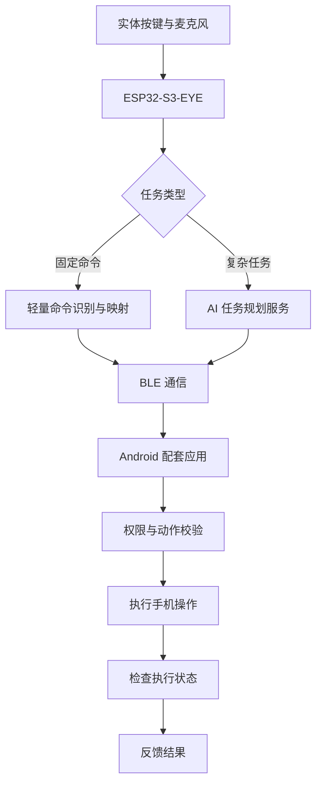

# PocketPilot

### 少一点找按钮，多一点直接行动。

**PocketPilot is an experimental physical AI interface for Android.**

PocketPilot 探索一种更直接的手机交互方式：用户通过实体设备表达意图，由系统理解指令、执行经过授权的手机操作，并反馈执行结果。

它不是一个已经能够控制所有手机应用的万能助手，而是一个从具体、高频操作开始，逐步验证人机交互新方式的硬件 AI 原型。

> **核心想法：从“我该点哪里”，到“我想完成什么”。**

---

## The Story｜为什么做 PocketPilot？

想象这样一个场景。

你刚收到一条包含地址的消息，准备打开地图查看位置。

你需要切换到聊天应用，找到那条消息，复制地址，再打开地图并粘贴搜索。每一步都很简单，但整个过程需要不断操作屏幕、切换上下文。

如果你只需要说一句话呢？

你按下随手可触及的实体设备，说出：

**“把刚收到的地址打开地图。”**

PocketPilot 希望把这句话转化为一系列可执行的动作：识别任务、获取经过授权的信息、打开地图、搜索地址，并告诉你任务是否完成。

这就是它希望探索的交互体验。

*这个多步骤场景属于产品目标，尚不能视为已经实现的功能。*

## The Product｜它是什么？

PocketPilot 将三个部分组合成一个交互闭环：

- **Physical Interface**：实体设备提供按键和语音入口。
- **Intent Processing**：简单命令优先走轻量处理路径，复杂任务再交由 AI 规划。
- **Controlled Execution**：Android 配套应用执行被允许的操作，并尽可能核验执行结果。

真正需要验证的，不只是 AI 能否理解一句话，而是用户表达的意图能否可靠地转化为手机上的实际动作。

## The First Milestone｜第一个可验证的结果

第一版不追求一开始就控制整部手机。

它只聚焦一个足够小、可以重复演示的闭环：

**按下实体按键 → 说“打开地图” → 手机实际打开地图 → 获得执行状态反馈。**

首版计划支持以下基础命令：

| 命令                    | 预期动作             |
| --------------------- | ---------------- |
| `COMMAND_OPEN_MAP`    | 打开已安装的地图应用       |
| `COMMAND_OPEN_WECHAT` | 打开已安装的微信         |
| `COMMAND_BACK`        | 在必要授权与适用条件下返回上一页 |

这些是首版的目标命令，并不代表全部已经完成。

项目将先使用 Android 模拟器验证手机端的命令处理和基础操作，再连接 ESP32-S3-EYE 进行真实硬件联调。模拟器中的成功结果，不会被当成真实 BLE 通信或整机测试已经通过。

## The Experience｜从一句话到一个动作

### 01 — Speak

用户按下实体按键，通过语音表达需求。

### 02 — Understand

系统识别命令。对于明确的固定指令，尽量使用轻量处理方式；对于涉及上下文的复杂任务，再考虑 AI 规划。

### 03 — Act

Android 配套应用校验命令和权限，再执行支持的手机操作。

### 04 — Verify

系统检查可获得的执行状态，并反馈成功、失败或尚未确认。

**发送了命令，不等于任务已经完成。** PocketPilot 将执行状态反馈视为产品闭环的一部分。

## System Design｜系统如何工作？

### Hardware — ESP32-S3-EYE

作为实体交互端，开发板用于探索按键、麦克风、有限语音命令识别、无线通信和状态反馈。

ESP32-S3-EYE 主要承担轻量交互任务，并不以独立运行大型语言模型为目标。实际支持的本地中文语音识别能力，需要结合 ESP-IDF、ESP-SR 版本和音频硬件配置验证。

### Mobile — Android Application

Android App 负责接收和验证命令、启动支持的应用，以及在用户主动授权后调用适用的系统能力。

部分操作依赖 Android 版本、应用行为及无障碍服务等权限，不能保证所有第三方应用都能被同样控制。

### AI — Task Planning

AI 用于处理固定命令难以覆盖的自然语言任务，将需求拆解为有限、明确的操作步骤。

复杂任务可以由电脑端或云端服务承担。模型生成的计划必须经过校验，不能直接转化为任意代码或不受限制的点击操作。

## Validation｜我们如何证明它真的可用？

PocketPilot 将以可重复的实际测试，而不是功能宣称，推进原型开发。

重点观察以下指标：

- **命令识别正确率**：不同距离和环境下，系统能否正确理解指令。
- **端到端响应时间**：从用户开始发出指令，到手机动作及结果反馈所需的时间。
- **执行成功率**：重复执行同一命令时，手机是否真的完成目标动作。
- **错误处理能力**：遇到断连、权限不足、应用未安装或识别不确定时，系统能否明确反馈而不是误报成功。

上述指标尚需通过实测建立基线。不会提前宣称未经测量的响应时间或准确率。

## Current Status｜项目当前状态

**Project stage: Prototype development**

项目当前处于产品定义与原型开发阶段。

| 模块                | 状态         |
| ----------------- | ---------- |
| 产品定位与最小闭环设计       | 已整理方案      |
| ESP32-S3-EYE 硬件准备 | 已具备开发板，已烧录     |
| 实体按键（GPIO0）      | 已实现，机械按压待人工验证 |
| 设备侧 BLE 链路（GATT 契约） | 已通过（电脑端，非手机） |
| Android 模拟器测试     | 已完成回归（模拟输入）  |
| 实体安卓手机 ↔ 开发板      | 尚待实机验证     |
| 本地中文命令识别          | 开发板已通过（3/3 命令词，单样本） |
| AI 多步骤任务执行        | 规则规划器已在模拟器通过（真实通知/云端规划未接入） |
| 完整端到端产品演示         | 尚待完成（缺实体安卓手机） |

状态只有在实际运行并获得可复现证据后才会更新。概念图、模拟命令和单元测试不能替代整机演示。

## Roadmap｜从一个动作开始

- 使用 Android 模拟器完成基础命令处理与状态反馈。
- 确认 ESP32-S3-EYE 的按键、音频和工程配置。
- 建立并验证 ESP32 与 Android 之间的真实 BLE 通信。
- 验证可用的中文本地命令识别方案。
- 完成实体按键、语音、手机动作、结果反馈的端到端演示。
- 在基础链路稳定后，加入受约束的 AI 多步骤任务。
- 邀请目标用户测试，记录真实使用场景、失败原因和持续使用意愿。

## Privacy & Safety｜权限与用户控制

- 只使用用户明确授权的系统权限和功能。
- 尽可能减少不必要的数据收集与传输。
- 对发送消息、付款、删除等敏感动作要求额外确认。
- 将命令已接收、操作已执行和结果已确认区分开来。
- 保留取消任务、管理授权及查看执行状态的能力。

PocketPilot 不承诺控制所有 Android 应用，也不假设 Android 与 iOS 具有相同的系统操作能力。

## Why This Project?｜我们真正想验证什么？

PocketPilot 不以“增加更多 AI 功能”为唯一目标。

我们更想回答一个具体的问题：

**当用户可以通过一个实体入口直接表达意图时，哪些手机操作会真正变得更方便？这种便利是否足以让用户持续使用它？**

从一条可验证的命令开始，再逐渐扩展到更复杂的任务。

欢迎通过 GitHub Issues 分享使用场景、测试反馈和改进建议。

---

**PocketPilot — Turn intent into action.**

*一个从实体语音入口出发，探索更直接手机交互方式的硬件 AI 原型。*
